# Keystrand

Keystrand is a free, open source Redis and Valkey client for macOS 26, built
with SwiftUI. It provides a Browser for every key type, a command Workbench,
database analytics, and bundled tutorials. It uses no telemetry, accounts, or
cloud features. The project uses the MIT License.

[RedisInsight](https://github.com/RedisInsight/RedisInsight) inspired the feature
set. Keystrand can import RedisInsight connection export files. Keystrand is
not affiliated with or endorsed by Redis Ltd.

## Screenshots

The screenshots show the Release build connected to Redis 8.10 in dark mode
with the bundled sample data. Some windows were in the background during
capture, so their sidebars and titles show the inactive window style.

The gallery covers these screens:

| Screen | Screenshot |
| --- | --- |
| Saved databases | 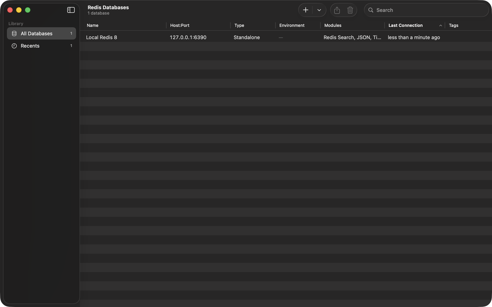 |
| Add a database | 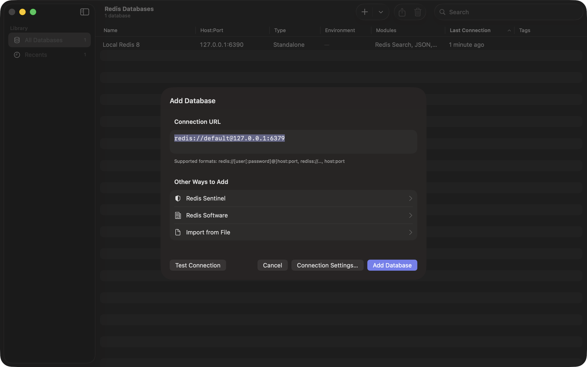 |
| Browser, tree view | 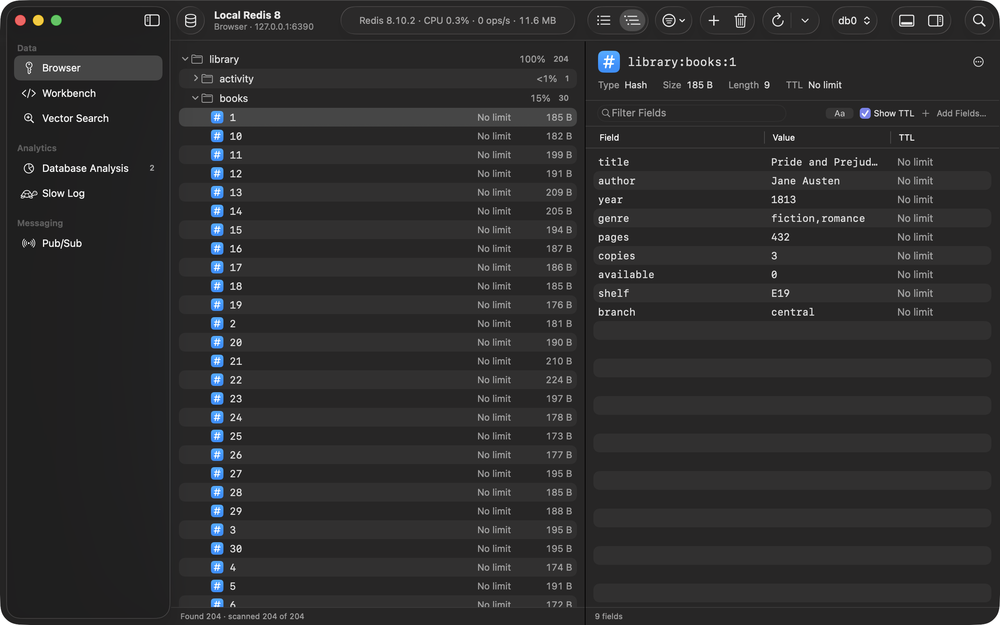 |
| Hash key | 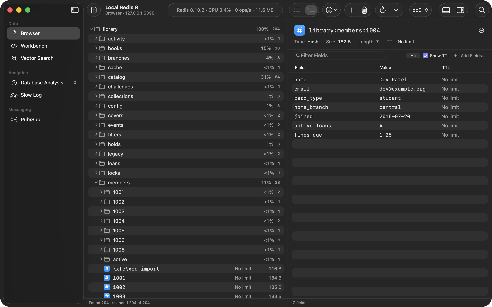 |
| JSON key | 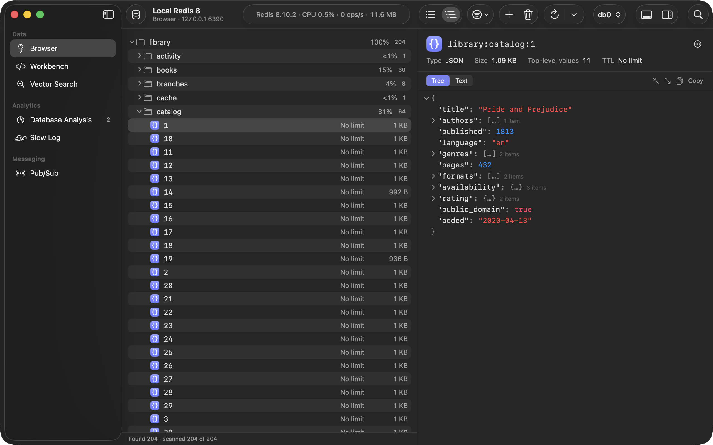 |
| Workbench search results | 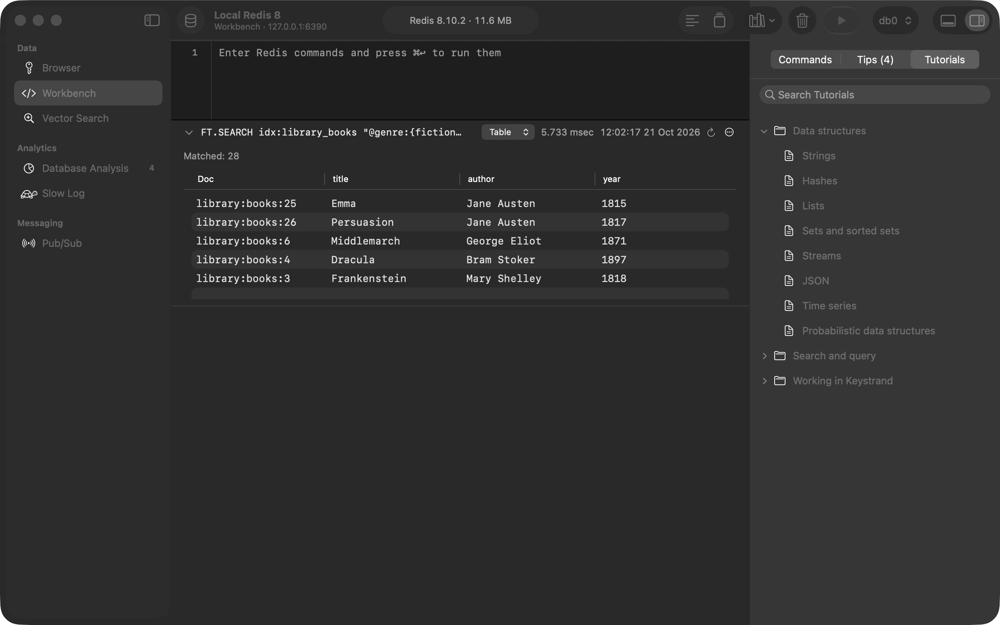 |
| CLI in the bottom panel | 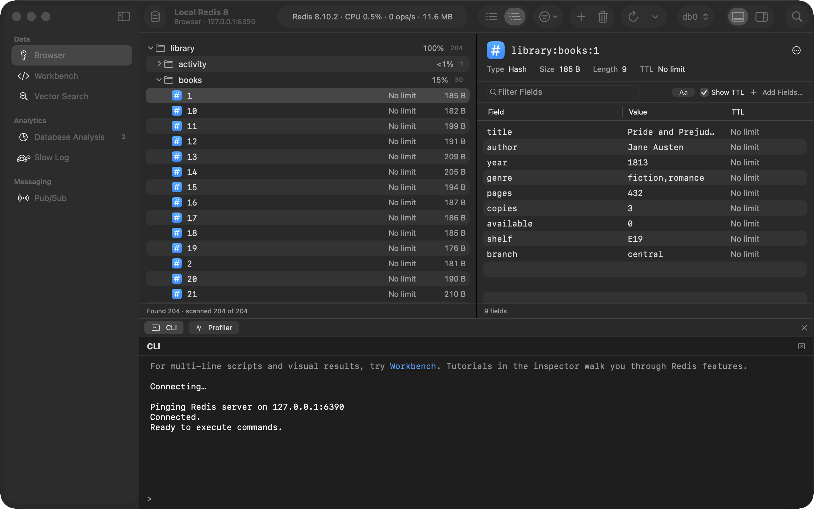 |
| Database Analysis | 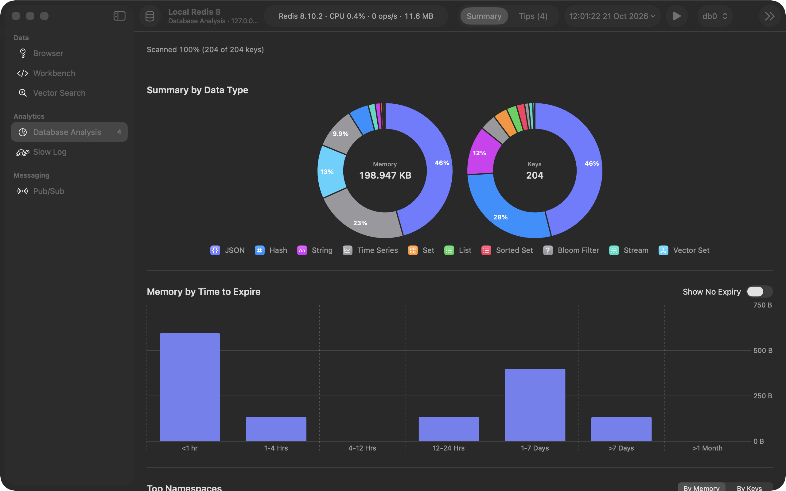 |
| Vector Search indexes | 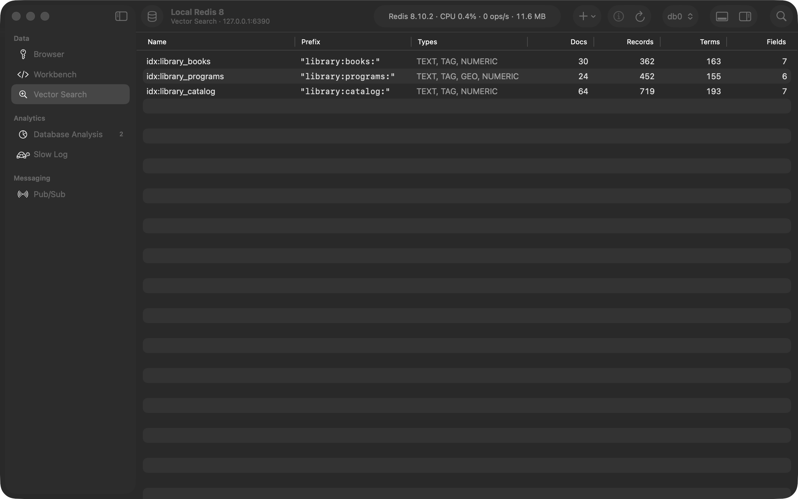 |
| Settings | 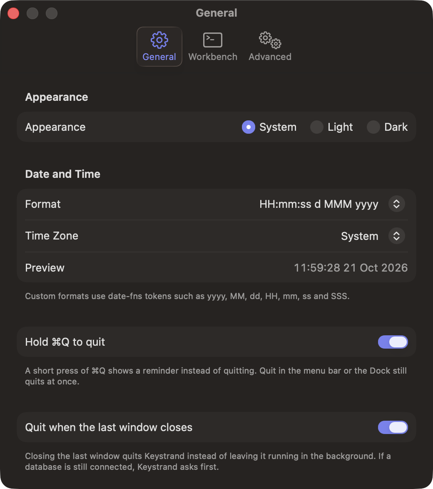 |
| About | 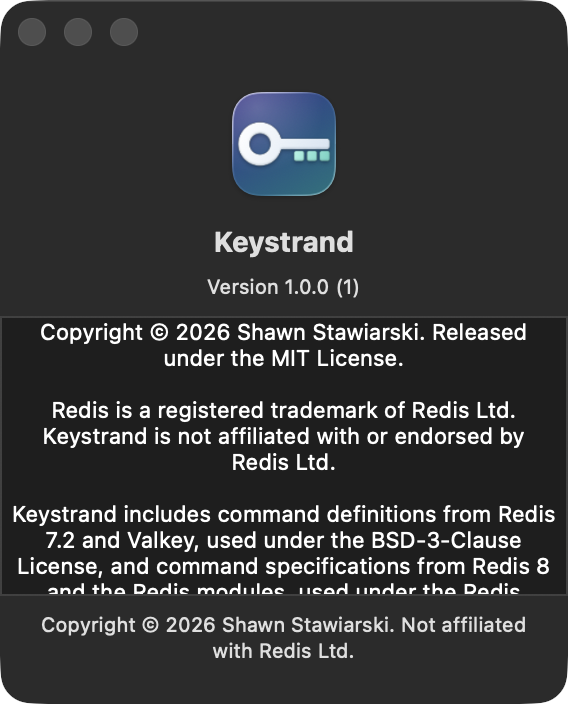 |

## Features

Keystrand supports Redis 6 through 8 and Valkey 8 and 9 in standalone, cluster,
or Sentinel deployments. It detects modules and supports JSON, Search,
TimeSeries, Bloom, and vector sets.

Keystrand includes these features:

- **Databases.** Save databases with tags, environments, and connection history.
  Sort or search the Redis Databases window. Add connections by URL or form.
  Configure TLS with SNI, CA certificates, or client certificates. Use SSH
  tunnels, Sentinel, connection scripts, and value formats for each database.
  Discover Sentinel primaries and Redis Software databases. Import or export
  connections with or without passwords. Production databases show a red label
  and require confirmation before writes.
- **Browser.** Browse keys in a list or tree with incremental scanning, pattern
  and type filters, search history, automatic refresh, and an `FT.SEARCH` mode.
  View and edit strings, hashes with field TTLs, lists, sets, sorted sets,
  streams with consumer groups, JSON, time series, vector sets, and arrays.
  Display values as Unicode, HEX, Binary, JSON, Msgpack, PHP, Protobuf, Pickle,
  Java, or vectors. Decompress GZIP, LZ4, Snappy, Brotli, and ZSTD values.
  List and open keys that contain invalid UTF-8. Use Bulk Actions to delete
  keys by filter or upload a command file. Use Load Sample Data to add a small
  library dataset.
- **Workbench.** Write commands with highlighting, completion, signature hints,
  and history. View results as tables, JSON trees, query plans, time series
  charts, or maps for GEO commands. Run code blocks in the bundled tutorials.
- **CLI and Command Helper.** Run individual commands on a dedicated CLI
  connection with Tab completion, argument hints, and history. Search the
  bundled reference with Command Helper, which updates as you type.
- **Analytics.** Use Database Analysis to inspect memory and key counts by type,
  expiry, namespace, and top keys. Read tips to reduce memory use. Inspect Slow
  Log results for each cluster node. Use Cluster Details to inspect metrics and
  primary nodes.
- **Pub/Sub and Profiler.** Subscribe to channel patterns or publish messages.
  Run `MONITOR` on every node with Profiler. Save the Profiler log to a file.
- **Vector Search.** Browse indexes or create an index from existing keys. Run
  queries with Explain and Profile. Use the query library and two sample datasets.
- **Mac app.** Use Liquid Glass, system colors, and light or dark appearance.
  Each database opens in its own window. The inspector contains Command Helper,
  Tips, and Tutorials. The bottom panel contains CLI and Profiler. The menu bar
  provides keyboard shortcuts.

## Requirements

To build Keystrand, you need the following:

- macOS 26 or later.
- The Xcode version in `.xcode-version`.
- [Homebrew](https://brew.sh).
- Docker if you use containers for test servers. The Homebrew servers installed
  by `scripts/bootstrap.sh` do not need Docker.

## Build and install

Keystrand has no prebuilt binary. Run these commands to build and install the app:

```bash
scripts/bootstrap.sh
scripts/install.sh --open
```

`scripts/bootstrap.sh` checks Xcode and installs the build tools in `Brewfile`.
It also installs the commit message hook from `.githooks`.

`scripts/install.sh` builds the Release app at `dist/Keystrand.app` and signs it
with the hardened runtime. The script quits any running copy before it replaces
the app in `/Applications`. The `--open` flag launches the installed app.
Use `--skip-build` to sign and install the existing `dist/` build.

By default, the script signs with a self-signed certificate named `Keystrand Local`.
A stable identity lets Keychain remember permission to read saved passwords.
With an ad hoc signature, macOS can ask again after each build. If the certificate
is missing, the script offers to create it with `scripts/make-signing-cert.sh`.
macOS then asks for your login password once.

Set `SIGN_IDENTITY` to use another signing identity. Set `INSTALL_DIR` to change
the install location, for example `INSTALL_DIR=~/Applications`.

The version comes from the nearest `v*` Git tag. Without a matching tag, the
version is `0.0.0-dev`. To build with Xcode or `xcodebuild`, read the
[contributor guide](CONTRIBUTING.md).

## Run

Launch flags open specific screens for checks and screenshots. Any launch flag
causes Keystrand to ignore saved window state for that run.

Use these flags to select a window, section, or tool:

| Flag | Effect |
| --- | --- |
| `--home` | Show the Redis Databases window |
| `--home --add-database` | Open the Add Database sheet |
| `--open host:port[/db]` | Save a `host:port` database and open it |
| `--open-id <databaseID>` | Open a saved database |
| `--section <name>` | Select a section |
| `--tool cli\|profiler\|helper` | Open a tool; repeat to open more tools |
| `--inspector helper\|tips\|tutorials` | Show an inspector pane |
| `--key <name>` | Select a key in the Browser |
| `--sheet <name>` | Open a sheet |
| `--settings [<tab>]` | Open Settings at `general`, `workbench`, or `advanced` |
| `--shortcuts` | Open the Keyboard Shortcuts window |
| `--appearance light\|dark` | Set the appearance for this run |
| `--window-size WxH` | Set the first window's size |

For `<name>` in `--section`, use `browser`, `workbench`, `vectorsearch`,
`analysis`, `slowlog`, `cluster`, or `pubsub`. For `<name>` in `--sheet`, use
`new-key`, `bulk-actions`, `edit-database`, `tags`, or `sample-data`.

`KEYSTRAND_DATA_DIR=<dir>` stores app data in `<dir>` instead of Application
Support. `KEYSTRAND_DISABLE_AUTODISCOVERY=1` disables the first-run scan,
which otherwise probes every local listening port.

## Where data is stored

Keystrand stores app data in the following locations:

| Data | Location |
| --- | --- |
| Saved databases, without secrets | `databases.json` |
| Passwords, SSH keys, client certificate keys | Keychain, `Keystrand` |
| CA and client certificates | `certificates.json` |
| App settings | `settings.json` |
| Per-database settings | `database-settings/<id>.json` |
| Workbench and Vector Search history | `workbench/<id>*.json` |
| Vector Search query library | `QueryLibrary.json` |
| Database Analysis reports | `Analysis/<id>/` |
| Profiler logs | `ProfilerLogs/` |

Except for Keychain items, Keystrand stores this data as plain JSON under
`~/Library/Application Support/Keystrand`. If you set `$KEYSTRAND_DATA_DIR`,
Keystrand uses that directory instead.

A link in the form
`keystrand://databases/connect?redisUrl=…&databaseAlias=…&redirect=…` adds or
reuses a database and connects to it. If the connection needs TLS certificates,
the link opens a prefilled Add Database sheet.

Keystrand sends no telemetry. It connects to servers you configure and scans
local ports on first run to discover servers. Read the [privacy policy](PRIVACY.md)
for details about network connections and stored data.

## Tests

The tests use Swift Testing. Unit tests need no server. Live tests carry the
`live` tag and use these servers:

- Redis 8 with modules on port 6390.
- Valkey 9 on port 6392.
- A three-node Valkey 9 cluster on ports 7001–7003.

`scripts/test-servers.sh` starts the Docker containers `keystrand-test`,
`keystrand-valkey` with the Valkey bundle modules, and `keystrand-vkc-0/1/2`.
Use `native` to start Homebrew `redis-server` and `valkey-server` processes.
CI uses native mode.

Use these commands to manage test servers and run tests:

```bash
scripts/test-servers.sh                # start all containers
scripts/test-servers.sh start redis    # only Redis 8 on 6390
scripts/test-servers.sh stop           # also: status
scripts/test-servers.sh native         # Homebrew servers instead of Docker
swift test --scratch-path .build/dev
swift test --scratch-path .build/dev --filter BrowserFeatureTests
```

Live tests skip if their server is unavailable. Tests that need Search, JSON,
time series, Bloom, or vector sets also skip if the server lacks that module.
Set `KEYSTRAND_REQUIRE_LIVE=1` to fail tests when a server is missing.
Set `KEYSTRAND_SKIP_LIVE=1` to skip every live test.

The tests never connect to port 6379 or send `FLUSHDB` or `FLUSHALL`.
The suite contains about 1,600 tests in 17 test targets.

## Known limitations

The following limitations apply:

- Pub/Sub has no jump-to-latest button.
- Cluster tests use a Valkey cluster and mock clients. Sentinel, SSH tunnels,
  and Redis Software discovery have no end-to-end tests.
- Sentinel connections do not use SSH tunnels.
- If a connection drops, Keystrand detects it on the next failed status check
  and offers **Reconnect**. It does not restart SSH tunnels for cluster nodes.
- Changes to a database's host, port, TLS, or similar settings close its Pub/Sub
  and Profiler connections. The CLI reconnects automatically.
- On Redis 8, any `FLUSHDB` or `FLUSHALL` drops every search index. Keystrand
  asks for confirmation before it runs either command.
- Search query completion supports field names and APPLY functions.
  Syntax highlighting skips very large editor contents.
- Workbench has no map view for geo results from `FT.SEARCH` or `FT.AGGREGATE`.
- Keystrand loads very large JSON values in full instead of in pages.
- ZSTD frames that need a dictionary are unsupported. Keystrand does not check
  ZSTD or Snappy checksums. It decodes only the first member of a multi-member
  GZIP value.

## Contributing

Use the [contributor guide](CONTRIBUTING.md) to set up the project, run tests,
format code, and open a pull request. Bug reports and focused pull requests
are welcome. [CLAUDE.md](CLAUDE.md) summarizes code conventions for AI coding
tools and contributors. Use only Apple frameworks. The project has no
third-party packages.

Report security problems privately as described in the [security policy](SECURITY.md).

## License

Keystrand uses the [MIT License](LICENSE). The command specification files in
`Sources/CommandSpecs/Resources/Commands/` use separate licenses:

- `redis.json` comes from the command definitions in Redis 7.2.4 and Valkey
  9.1.2 under BSD-3-Clause, and Redis 8.4.7 under the Redis Source Available
  License 2.0. `scripts/make-redis-commands.py` generates the combined file.
- `redisbloom.json`, `redisearch.json`, `redisgraph.json`, `redisjson.json`, and
  `redistimeseries.json` are unmodified copies of the modules' `commands.json`
  files. Keystrand uses them under the Redis Source Available License 2.0.

Read [Third-party notices](THIRD_PARTY_NOTICES.md) for sources, copyright
notices, and changes. [LICENSES/](LICENSES) contains the full license texts.

Redis is a registered trademark of Redis Ltd. Keystrand is not affiliated with
or endorsed by Redis Ltd.

The app bundle includes the notices. Choose **Help > Acknowledgements** to
read them. **About Keystrand** names the applicable licenses.

The tutorials, tips, and sample data are original to this project. The sample
book titles refer to public-domain works.
